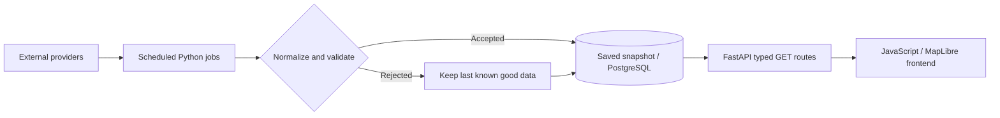

# CanariasCerca · Engineering Case Study

**Interactive technical portfolio:** [Live demo](https://paulinap92.github.io/canarias-cerca-demo/) · [Real production website](https://canariascerca.es)

This repository is **not a copy of the CanariasCerca tourism portal**. It is an English-language, recruiter-oriented engineering walkthrough of the platform's backend design: data ingestion, refresh jobs, typed FastAPI routes, validation, persistence boundaries and frontend delivery.

## What you can actually try

| Module | Interactive behavior | Source of truth |
| --- | --- | --- |
| Data pipeline | Select nodes, replay a successful refresh or injected provider outage | Conceptual architecture grounded in backend modules |
| FastAPI playground | Modify `island`, `limit`; receive typed success/422-style error examples | The real FastAPI places route uses `Query(100, ge=1, le=500)` |
| Background jobs | Replay task traces and inspect intervals | The backend cache-warmer defines 600 / 1800 / 3600 / 21600-second loops |
| Code browser | FastAPI route, `asyncio` loop, validation example, JavaScript | Marked excerpts: authentic structure, adapted or illustrative when noted |
| Design decisions | Read about snapshot fallback, request contracts and read/write separation | Engineering rationale, not confidential implementation |

**Important limitation:** the interactive web app is static JavaScript hosted on GitHub Pages. It does **not** run FastAPI, connect to Neon, perform real data ingestion or query production. All sample responses, places and logs are fictional. Job intervals listed are taken from the cache-warmer module; they do not prove an end-to-end provider refresh SLA.

## Technologies used in the real system

`Python` · `FastAPI` · `Pydantic / Query` · `PostgreSQL / Neon` · `asyncio / httpx` · `MapLibre GL JS` · `JavaScript` · `GitHub Actions`

## Architecture



See the live pipeline node inspector for design details. The diagram is deliberately high-level and does not expose private persistence mappings or provider configuration.

## Source excerpt policy

Excerpts are deliberately small, with formatting normalized for readability and internal integration code omitted. The repository does **not** include credentials, production prompts, provider configurations, proprietary data models or full copies of private repositories. Pydantic and client-side JavaScript snippets explicitly identify which examples are illustrative versus sourced.

## Real screenshots

The optional product-reference gallery contains two screenshots of the public homepage captured with Playwright, available at `screenshots/production-desktop.png` and `screenshots/production-mobile.png`. They are intentionally **not the hero or the focus**: reviewers can open the real product instead.

## Run & test locally

```bash
python -m http.server 8000
# open http://localhost:8000
node --test tests/*.test.js
```

No dependency installation is needed for tests. A GitHub Actions workflow runs tests on each push and deploys to GitHub Pages.

## Security and accuracy

- No production API calls in the browser implementation.
- No database or provider tokens, production credentials or internal endpoints.
- Clearly labeled fictitious fixture data and no invented production metrics.
- All technical documentation, code, comments, commits and recruiter-facing UI are in English.
- This project does not modify or deploy the real CanariasCerca product.

---

**Portfolio focus:** backend systems thinking, validation contracts, robust ingestion and failure handling, not a visual recreation of a tourism website.
