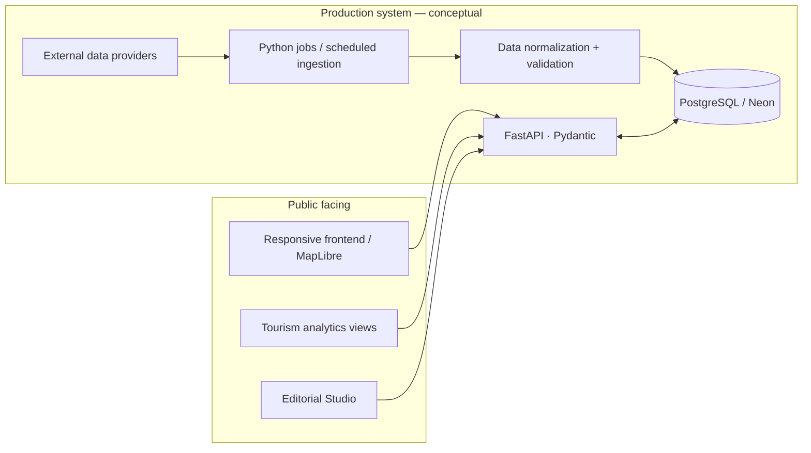

# CanariasCerca — Interactive Engineering Portfolio Demo

[**Live demonstration**](https://paulinap92.github.io/canarias-cerca-demo/) *(available after the repository is created and Pages is enabled)* · [Production product](https://canariascerca.es)

> **Public-safe portfolio case study.** Not a mirror of the production application. All location collection records and operational observations are independently prepared examples; weather, calima, seismic values and tourism indexes are fabricated.

## Authentic product screenshots

Two **real screenshots of the public production homepage**, captured by the project owner with Playwright on **November 26, 2026**, are included in `screenshots/`:

- [Desktop — 1440 × 900](screenshots/production-desktop.png)
- [Mobile — 390 × 844](screenshots/production-mobile.png)

They appear responsively in the hero and in the expandable screenshot gallery, with links to the original PNG files. Capture provenance is recorded in [screenshots/capture-metadata.json](screenshots/capture-metadata.json) and the [screenshot gallery documentation](docs/production-screenshots.md). Screenshots show the **real public product**, while the surrounding interactive portfolio demo uses **fictional offline data**.

To capture updated public screenshots on Windows using `uv`:

```powershell
uv run --with playwright python -m playwright install chromium
uv run --with playwright python tools/capture_public_site.py
```

Review any new captures before publishing. The helper opens the public homepage only and does not authenticate to a CMS or access production Studio.

## Real source excerpt (selected, non-secret)

The architecture section contains a short excerpt from **app/api/places.py**, with formatting simplified for readability. Additional small samples are in [docs/source-excerpts.md](docs/source-excerpts.md). The real repositories, prompts, database credentials, and operational implementation remain private.

## What can you try?

| Interactive section | What it demonstrates |
| --- | --- |
| Explore & Map | MapLibre GL JS, search, island/category filters, selectable geographic points |
| Live data layers | Weather, PM10/calima, seismic sample observations and a local pipeline job simulation |
| Analytics | Interactive monthly index chart, separation of ingestion from reporting |
| Editorial Studio | Local draft selection, title/summary editing and publication-card preview |
| Architecture | Clear FastAPI/Pydantic, PostgreSQL/Neon, Python jobs, MapLibre responsibilities |

**Production-oriented technical scope:** FastAPI, Pydantic, Python, PostgreSQL/Neon, MapLibre, scheduled ingestion, data normalization, API responses, editorial controls and data visualizations.

The Pages implementation is **vanilla JavaScript** for safe browser-only interaction. GitHub Pages does not run FastAPI or database services. There are no API calls to production in this repository. A job button simulates state updates locally; it is not a production scheduler.

## System architecture



See [architecture notes](docs/architecture.md) and [security boundary](SECURITY.md).

## Language policy

The public user interface uses **Spanish** for the target audience. Technical documentation, source identifiers, code comments, test descriptions, Git commit messages, and architecture notes are in **English**. Fictional editorial content follows the interface language.

## Local development

```bash
python -m http.server 8000
# http://localhost:8000
```

Run tests with `npm test` (Node.js 20+; no install needed).

## GitHub Pages deployment

1. Create a public repository named `canarias-cerca-demo` under `paulinap92`.
2. Push the **contents of this directory** to its `main` branch (not the parent folder).
3. Set **Settings → Pages → Build and deployment → Source: GitHub Actions**.
4. Workflow `.github/workflows/pages.yml` tests and publishes the static site on pushes to `main`.

This repo is standalone and cannot affect any production deployment.

## Engineering story

The real product joins maps, curated content, continuous collection of external observations and visualization. The case study emphasizes typed API boundaries, data quality, ingestion orchestration, fallbacks and user-facing exploration. Its aim is to communicate engineering decisions without publishing proprietary implementation details.

**Privacy:** No production schemas, prompts, passwords, tokens, private endpoint names, internal configuration or copied private source code.
